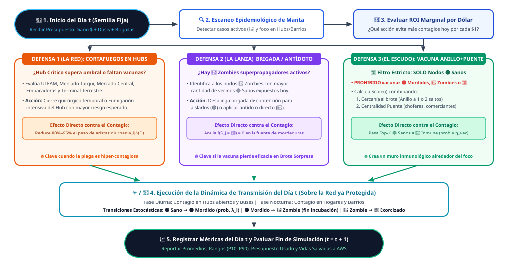
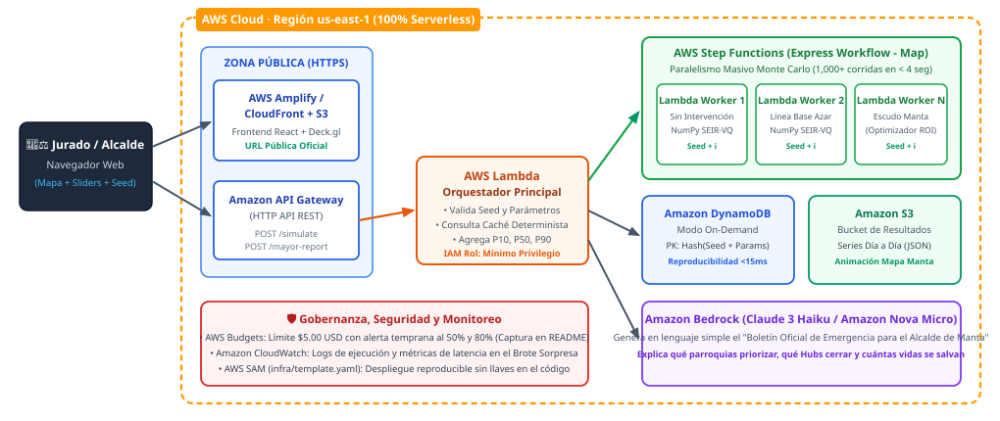
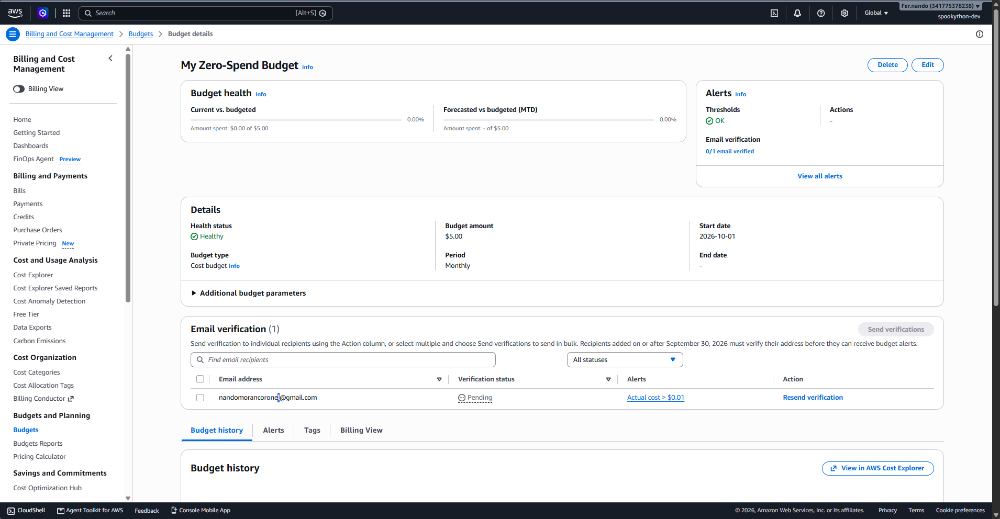

# Operación Cortafuegos Manta

> SpookyThon 2026 · Track B · La Plaga Zombie

**Aplicación desplegada en AWS:** https://main.d2rdluo4raik0f.amplifyapp.com

**API (Amazon API Gateway, `us-east-1`):** `https://efrokac0z1.execute-api.us-east-1.amazonaws.com/prod` (por ejemplo, [`/health`](https://efrokac0z1.execute-api.us-east-1.amazonaws.com/prod/health))

## Qué hace el proyecto

**El problema.** Cuando llega un brote, el Comité de Operaciones de Emergencia (COE) de Manta tiene que decidir rápido y con poco dinero a quién vacunar, a quién aislar y qué lugares cerrar. Gastar mal ese dinero se paga en contagios.

**Lo que hicimos.** Una herramienta que simula día a día cómo se propaga una plaga por una red de contactos de Manta (hogares, barrios, mercados, la ULEAM, las empacadoras, el terminal y los buses) y que, con un presupuesto que llega por días, decide cada día qué comprar:

- **vacunas** para las personas sanas que rodean a los casos y para quienes conectan barrios;
- **brigadas** que aíslan a los casos detectados con más contactos;
- **cierres o fumigaciones** de hubs cuando la epidemia se descontrola.

La estrategia, **Escudo Manta**, elige cada día la acción que más contagios evita por dólar. Se compara siempre contra **no hacer nada** y contra **gastar el mismo dinero al azar**, con 30 simulaciones por estrategia, promedios y rangos P10–P90.

**Resultado con los valores por defecto (semilla 2026):**

|                                 | Sin intervención | Al azar | **Escudo Manta** |
| ------------------------------- | ---------------- | ------- | ---------------- |
| Personas contagiadas (de 1 200) | 842 (70%)        | 51      | **14,5**         |
| Pico de zombies a la vez        | 279,6            | 16,3    | **5,0**          |

El Escudo evita el **98%** de los contagios frente a no hacer nada y el **72%** frente al azar, sin vacunar nunca a quien ya está infectado o es inmune. Escalado a los 271 000 habitantes de Manta, son unos **187 000 contagios evitados**.

**Cómo se usa.** Una consola web (ver [Interfaz](#interfaz)) permite cambiar el contagio, las vacunas, el presupuesto y el punto de inicio, aplicar los **Brotes Sorpresa** del reto con un clic, ver el avance en un mapa de Manta y generar una propuesta de decreto para el alcalde en lenguaje simple. El cálculo corre en AWS (Lambda + Step Functions) o en un servidor local de respaldo.

**Utilidad real.** Es, en pequeño, lo que usan los ministerios de salud para planificar vacunación, cierres o fumigación con recursos limitados.

## Modelo epidemiológico

### La plaga

Una plaga zombie ficticia, de contagio directo entre personas. Su contagiosidad está calibrada para parecerse a la **COVID-19 (cepa original)**: cada zombie contagia en promedio a **2,9 personas** (R₀ ≈ 2,9; la COVID-19 original ronda 2,8). Sus tiempos son cortos, como los de la influenza, para que el brote se desarrolle dentro de una simulación de 30 días. La plaga no mata: convierte.

Cada persona está siempre en uno de estos 5 estados:

| Código | Estado                 | Qué significa                                                                | Cuánto dura                       |
| ------ | ---------------------- | ---------------------------------------------------------------------------- | --------------------------------- |
| 0      | 🟢 Sano                | Puede contagiarse                                                            | Hasta que lo muerden o lo vacunan |
| 1      | 🟡 Mordido             | Infectado en incubación: todavía no contagia y nadie sabe que está infectado | 2 días (`incubation_days`)        |
| 2      | 🔴 Zombie              | Contagia a sus contactos                                                     | 5 días (`infectious_days`)        |
| 3      | 🟣 Aislado             | Zombie retirado por una brigada: ya no contagia                              | Hasta completar sus 5 días        |
| 4      | 🔵 Exorcizado / Inmune | Recuperado, o vacunado con éxito. No vuelve a contagiarse                    | Permanente                        |

Caminos posibles:

- 🟢 Sano → 🟡 Mordido → 🔴 Zombie → 🔵 Inmune
- 🔴 Zombie → 🟣 Aislado (brigada) → 🔵 Inmune
- 🟢 Sano → 🔵 Inmune (vacuna, funciona en el 85% de los casos)

### La población: red de contactos de Manta

La organización no entrega datos, así que generamos una **población sintética de Manta** (por defecto, 1 200 personas) como una red de contactos. Cada persona es un punto y cada contacto es una línea con un **peso** entre 0 y 1,45: cuanto más alto, más cercano es el contacto y más fácil el contagio. Código: [`src/engine/graph_manta.py`](src/engine/graph_manta.py).

**Parroquias urbanas.** Cada persona vive en una de las 5 parroquias, repartidas según su peso de población:

| Parroquia    | Población |
| ------------ | --------- |
| Tarqui       | 38%       |
| Eloy Alfaro  | 24%       |
| Manta Centro | 22%       |
| Los Esteros  | 11%       |
| San Mateo    | 5%        |

**Hogares.** Las personas de una misma parroquia se agrupan en familias de 3 a 6 integrantes.

**Roles y hubs.** Cada persona tiene un rol, que decide a qué lugar de alta afluencia (hub) va durante el día:

| Rol            | % de la población | Adónde va de día                                           |
| -------------- | ----------------- | ---------------------------------------------------------- |
| Estudiante     | 22%               | ULEAM (70%) o un colegio de su barrio (30%)                |
| Comerciante    | 18%               | El mercado más cercano a su parroquia                      |
| Transportista  | 10%               | Terminal Terrestre, y además conduce buses                 |
| Obrero atunero | 20%               | Zona industrial / Empacadoras de Los Esteros               |
| Residente      | 30%               | El mercado más cercano (60%) o se queda en su barrio (40%) |

Los 5 hubs y qué tan contagioso es cada uno (multiplicador del peso de sus contactos):

| Hub                | Parroquia    | Multiplicador |
| ------------------ | ------------ | ------------- |
| Mercado de Tarqui  | Tarqui       | 1,45          |
| Terminal Terrestre | Eloy Alfaro  | 1,40          |
| Empacadoras        | Los Esteros  | 1,35          |
| ULEAM              | Manta Centro | 1,30          |
| Mercado Central    | Manta Centro | 1,25          |

**Dos capas de contactos:**

- **Noche (casa y barrio):** cada familia está conectada todos con todos (peso 0,85 a 1,0), y cada hogar tiene de 2 a 4 contactos con hogares vecinos de su parroquia (peso 0,25 a 0,45).
- **Día (hubs, barrio y buses):** dentro de cada hub, cada persona tiene contactos fijos (compañeros de aula, de puesto o de línea de producción) y algunos al azar (red de "mundo pequeño"). Quien no va a ningún hub tiene contactos de día en su barrio. Cada transportista lleva de 6 a 10 pasajeros de cualquier parroquia (peso 0,30 a 0,60): son los **puentes** por donde la plaga salta de un barrio a otro.

En promedio, cada persona tiene unos **9 contactos de día y 5 de noche**.

**Centralidad puente (`bridge_score`).** A cada persona se le da una nota de 0 a 1 que mide cuánto conecta parroquias distintas: 40% por la cantidad de contacto diario, 40% por cuántas parroquias distintas toca y 20% de bono por rol (transportistas y comerciantes). La estrategia la usa para vacunar a los puentes.

La red es **determinista**: con la misma semilla se genera siempre exactamente la misma ciudad.

### Cómo se contagia

La simulación avanza **día a día** (por defecto, 30 días). Código: [`src/engine/simulator.py`](src/engine/simulator.py).

**Día 0.** Se eligen los pacientes cero (por defecto 4) entre las personas que van al hub de inicio (por defecto, el Mercado de Tarqui). Se prefiere a quien tiene más contactos, porque un brote real suele empezar por quien más se mueve.

**Cada día, en este orden:**

1. **Llega el presupuesto** del COE (400 $/día, sin pasar el techo total de 8 000 $). Lo que no se gasta se guarda para el día siguiente.
2. **Vigilancia:** cada Zombie que todavía no ha sido reportado tiene un **35% de probabilidad** de ser detectado ese día. El COE solo conoce a los Zombies detectados; los Mordidos en incubación son invisibles.
3. **El COE decide** qué hacer con el dinero, según la estrategia (ver _Estrategia Escudo Manta_).
4. **Contagio de día** (hubs, barrio y buses).
5. **Contagio de noche** (casa y barrio), solo para quienes siguieron sanos durante el día.
6. **Avanza la enfermedad:** los Mordidos pasan a Zombie tras 2 días; los Zombies y los Aislados pasan a Inmunes tras 5 días.

**Fórmula del contagio.** Para cada persona sana se suma el riesgo de todos sus contactos que son Zombies:

$$\lambda_i = \sum_{j \in \text{contactos Zombie}} \beta \cdot w_{ij}$$

y su probabilidad de ser mordida ese día es:

$$p_i = 1 - e^{-\lambda_i}$$

donde:

- $\beta$ es la probabilidad base de contagio por contacto: **`beta_day` = 0,05** de día y **`beta_night` = 0,07** de noche. La de noche es mayor porque en casa el contacto es más cercano y largo.
- $w_{ij}$ es el peso del contacto (de 0,25 a 1,45, según la tabla de la población).
- Si el contacto ocurre en un **hub cerrado** ese día, su peso se reduce un **88%** (`hub_firewall_reduction`).

Con esta fórmula, un Sano con muchos contactos Zombie casi seguro se contagia, y uno con un solo contacto lejano tiene poca probabilidad. Ni los Mordidos ni los Aislados contagian: solo los Zombies activos.

### Estrategia Escudo Manta

**Idea central:** cada día, el COE compra **una a una** las acciones que **evitan más contagios por cada dólar**, hasta quedarse sin presupuesto. Es un algoritmo voraz de retorno marginal por dólar (ROI).

$$\text{ROI}(\text{acción}) = \frac{\text{contagios que se espera evitar}}{\text{costo de la acción}}$$

El COE solo usa la información que tendría en la realidad: los **Zombies detectados**. No sabe quién está Mordido.



_Un día de simulación: el COE recibe el presupuesto, ve los casos detectados, compra las acciones con más contagios evitados por dólar y después ocurre el contagio de día y de noche. Fuente: [docs/flujo_defensas.svg](docs/flujo_defensas.svg). Vista general del sistema en [docs/mapa_mental.svg](docs/mapa_mental.svg)._

**Las 3 defensas:**

| Defensa                       | Costo         | Qué hace                                                                      | Contagios que se espera evitar                                                                                                     |
| ----------------------------- | ------------- | ----------------------------------------------------------------------------- | ---------------------------------------------------------------------------------------------------------------------------------- |
| **Cortafuegos en un hub**  | 220 $ por día | Cierra o fumiga un hub ese día: sus contactos contagian un 88% menos          | Riesgo de hoy entre los Zombies detectados del hub y sus contactos Sanos, × 0,88, × 2 (por los Zombies que aún nadie ha reportado) |
| **Brigada de aislamiento** | 65 $          | Aísla a un Zombie detectado: deja de contagiar                                | Riesgo diario de ese Zombie hacia sus contactos Sanos (día + noche) × los días de contagio que le quedan                           |
| **Vacuna anillo + puente** | 15 $          | Vacuna a una persona Sana; funciona en el 85% de los casos y la vuelve Inmune | 0,85 × (65% por su cercanía a Zombies detectados + 35% por su centralidad puente) × β                                              |

**Vacunación anillo + puente.** Para cada persona Sana se combinan dos cosas:

- **Anillo:** cuántos Zombies detectados tiene a 1 salto, más una parte (25%) de los que tiene a 2 saltos. El segundo salto sirve para alcanzar a los Mordidos invisibles que suele haber alrededor de cada caso.
- **Puente:** su `bridge_score`. Vacunar a quien conecta parroquias (por ejemplo, un transportista) corta los caminos por donde la plaga salta de barrio.

**Regla de oro: nunca se vacuna a un infectado o inmune.** La lista de candidatos a vacuna se arma **solo con personas en estado Sano** que no hayan sido vacunadas antes. Además, cada dosis se audita: si alguna se aplicara a alguien que no está Sano, se contaría como desperdicio. El contador `wasted_vaccines_count` ha sido **0 en todas las simulaciones**.

**Se adapta sola al Brote Sorpresa.** No tiene reglas fijas del tipo "primero vacunar". Si el jurado baja la eficacia de la vacuna, el valor de vacunar baja automáticamente y el dinero se va a brigadas; si la plaga se vuelve mucho más contagiosa, cerrar hubs empieza a compensar. Por ejemplo, con una vacuna al 25% y el contagio de día al 0,18, el Escudo pasa de 10,7 a 63,6 brigadas y de 487 a 234 vacunas, sin cambiar el código.

**Cuándo usa cada defensa.** Con brotes controlables, le rinden más las brigadas (65 $) y las vacunas (15 $). Cerrar un hub cuesta 220 $ y solo protege un día, así que solo lo hace cuando la epidemia se descontrola y hay muchos contagios dentro de un mismo lugar (ver [docs/calibracion.md](docs/calibracion.md), fila 8).

### Líneas base y Monte Carlo

**Dos líneas base**, como pide el reto. Las tres estrategias se simulan con exactamente las mismas condiciones:

| Estrategia                             | Qué hace                                                                                                                                                                                                                                                                                                                     |
| -------------------------------------- | ---------------------------------------------------------------------------------------------------------------------------------------------------------------------------------------------------------------------------------------------------------------------------------------------------------------------------- |
| **Sin intervención** (`none`)       | No gasta nada. Muestra qué pasa si nadie actúa.                                                                                                                                                                                                                                                                              |
| **Intervención al azar** (`random`) | Recibe **el mismo presupuesto** cada día y **la misma información** (los mismos Zombies detectados) que el Escudo. Cada compra es al azar: elige un tipo de acción cualquiera (hub, brigada o vacuna) y un objetivo cualquiera, sin mirar anillos ni puentes. También respeta la regla de oro: solo vacuna a personas Sanas. |
| **Escudo Manta** (`shield`)         | La estrategia descrita arriba.                                                                                                                                                                                                                                                                                               |

Si el Escudo supera al azar, es porque **elige mejor**, no porque tenga más recursos.

**Monte Carlo: muchas repeticiones, no una sola.** Una sola simulación puede salir bien por suerte. Por eso cada estrategia se repite **30 veces** por defecto (`monte_carlo_runs`) y se reporta:

- La **media** de cada día.
- El rango **P10–P90**: P10 es un escenario favorable (solo el 10% de las repeticiones salió mejor), P50 el típico y P90 un escenario desfavorable.

**Comparación justa: números aleatorios comunes.** En la repetición número _k_, las tres estrategias usan la misma semilla derivada (`seed × 1000 + k`). Así comparten **el mismo paciente cero** y **la misma suerte en la detección de casos**. La diferencia entre ellas se debe a la estrategia, no al azar. Las vidas salvadas se calculan **repetición por repetición** (infectados del azar − infectados del Escudo) y luego se promedian.

**Reproducible.** Con la misma configuración y la misma semilla, el resultado es **exactamente el mismo**, en local o en AWS. Está verificado con pruebas automáticas (`tests/test_simulator.py`).

**En AWS**, las repeticiones se reparten en lotes que corren en paralelo en varias funciones Lambda (`run_batch_simulations`) y luego se juntan (`aggregate_batch_results`). El resultado es idéntico al de correrlas todas juntas en local.

### Parámetros por defecto y semilla

**Semilla oficial: `2026`.** Todos los valores están en `DEFAULT_SIMULATION_PARAMS` de [`src/engine/simulator.py`](src/engine/simulator.py).

**La simulación**

| Parámetro          | Valor             | Por qué                                                                                                                                                   |
| ------------------ | ----------------- | --------------------------------------------------------------------------------------------------------------------------------------------------------- |
| `seed`             | 2026              | Año del evento. Cualquier semilla sirve: el Escudo supera a las líneas base con todas las que probamos.                                                   |
| `n_nodes`          | 1 200 personas    | Muestra a escala de Manta (271 145 hab.) con estructura suficiente de hogares, hubs y buses, y que corre en ~1 s, dentro de los 5 min del Brote Sorpresa. |
| `days`             | 30                | Un mes: el tiempo en que la plaga se desarrolla y el presupuesto se agota (día 20).                                                                       |
| `monte_carlo_runs` | 30                | Repeticiones por estrategia: suficiente para medias y rangos P10–P90 estables, en ~1 s.                                                                   |
| `start_hub`        | Mercado de Tarqui | El hub más concurrido (multiplicador 1,45) de la parroquia más poblada.                                                                                   |
| `initial_infected` | 4                 | Un brote pequeño, como los que detecta un sistema de salud al inicio.                                                                                     |

**La plaga**

| Parámetro         | Valor | Por qué                                                                                        |
| ----------------- | ----- | ---------------------------------------------------------------------------------------------- |
| `beta_day`        | 0,05  | Junto con `beta_night`, da un R₀ ≈ 2,9, comparable a la COVID-19 original (ver _Calibración_). |
| `beta_night`      | 0,07  | Mayor que de día: en casa el contacto es más cercano y largo.                                  |
| `incubation_days` | 2     | Tiempos cortos, del orden de los de la influenza, para que el brote se desarrolle en 30 días.  |
| `infectious_days` | 5     | Ídem.                                                                                          |

**Recursos y costos** (escenario ficticio; lo importante es la proporción entre costos)

| Parámetro                | Valor         | Por qué                                                                                                                  |
| ------------------------ | ------------- | ------------------------------------------------------------------------------------------------------------------------ |
| `daily_budget`           | 400 $/día     | El dinero llega por días, como en una emergencia real.                                                                   |
| `total_budget`           | 8 000 $       | Dura 20 de los 30 días y no alcanza para todos: recursos realmente limitados.                                            |
| `vaccine_cost`           | 15 $          | La acción más barata e individual.                                                                                       |
| `brigade_cost`           | 65 $          | Equipo de personas varios días aislando a un caso: ≈ 4 vacunas.                                                          |
| `hub_closure_cost`       | 220 $ por día | Cerrar o fumigar un lugar con cientos de personas: la acción más cara. Abaratarlo favorecía al azar (ver _Calibración_). |
| `vaccine_efficacy`       | 0,85          | Supuesto: una vacuna buena pero no perfecta.                                                                             |
| `hub_firewall_reduction` | 0,88          | Un cierre no elimina todo el contacto (personal, abastecimiento): reduce el contagio un 88%.                             |

**Constantes internas del modelo** (en `simulator.py`)

| Constante                | Valor | Qué significa                                                                   |
| ------------------------ | ----- | ------------------------------------------------------------------------------- |
| `DETECTION_PROB`         | 0,35  | Probabilidad diaria de que un Zombie sea reportado: tarda en promedio 2–3 días. |
| `HIDDEN_CASE_FACTOR`     | 2,0   | Al valorar un cierre de hub, por cada Zombie detectado se estima otro oculto.   |
| `RING_SECOND_HOP_WEIGHT` | 0,25  | Peso de los contactos a 2 saltos en la vacunación en anillo.                    |

**Cómo reproducir los resultados**

```bash
python scripts/calibrar.py
```

Con los valores por defecto y la semilla 2026, el resultado debe ser exactamente:

| Sin intervención     | Al azar | Escudo Manta | Escudo vs azar         | Vacunas desperdiciadas |
| -------------------- | ------- | ------------ | ---------------------- | ---------------------- |
| 842 infectados (70%) | 51,4    | 14,5         | 71,79% menos contagios | 0                      |

**Comparación de las 3 estrategias** (media de 30 repeticiones; rango P10–P90 entre paréntesis; 1 200 personas, 30 días):

| Estrategia                     | Contagiados     | Pico de zombies | Gasto   | Vacunas | Brigadas | Días de hubs cerrados |
| ------------------------------ | --------------- | --------------- | ------- | ------- | -------- | --------------------- |
| Sin intervención            | 842,5 (753–922) | 279,6           | 0 $     | 0       | 0        | 0                     |
| Al azar (mismo presupuesto) | 51,4 (5–119)    | 16,3            | 7 995 $ | 178     | 15,7     | 19,6                  |
| **Escudo Manta**            | **14,5 (6–25)** | **5,0**         | 7 996 $ | 487     | 10,7     | 0                     |

Contagios evitados por el Escudo, comparados réplica a réplica: **828 frente a no hacer nada** (P10–P90: 738 a 909) y **36,9 frente al azar** (P10–P90: −8 a 101). El rango frente al azar empieza en negativo: en las repeticiones más favorables para el azar, el Escudo queda unas pocas personas por detrás, pero en promedio evita el 72% de los contagios que deja el azar. El azar gasta casi lo mismo, pero una buena parte en cerrar hubs al azar (19,6 días), que es la acción más cara.

Para probar otra configuración, se escriben los cambios como `nombre=valor`, por ejemplo: `python scripts/calibrar.py seed=42 vaccine_efficacy=0.5`.

### Calibración y verificación

El detalle completo de cada experimento está en [docs/calibracion.md](docs/calibracion.md).

**Qué ajustamos y por qué.** Con los valores iniciales, el modelo tenía dos supuestos poco creíbles: sin intervenir se infectaba el 97% de Manta en un mes, y con 12 000 $ se podían comprar vacunas para casi la mitad de la ciudad. Cambiamos un parámetro cada vez y anotamos el resultado:

- Bajamos el contagio (`beta_day` 0,085 → 0,05 y `beta_night` 0,110 → 0,07): sin intervenir se infecta el 70%, una epidemia grave pero creíble.
- Probamos abaratar el cierre de hubs, pero eso favorecía al azar (que cierra hubs por casualidad), así que lo descartamos.
- Bajamos el presupuesto (600 → 400 $/día y 12 000 → 8 000 $): los recursos pasan a ser realmente limitados.

**Comparación con una enfermedad real.** Con los valores elegidos, cada Zombie contagia en promedio a **2,9 personas** (R₀ ≈ 2,9), comparable a la **COVID-19 original** (mediana ≈ 2,8). El escenario "el doble de contagiosa" equivale a R₀ ≈ 5, como la **variante Delta**. Lo medimos con `python scripts/estimar_r0.py`.

**Verificación 1: el jurado elige la semilla.** Probamos 10 semillas distintas (1, 7, 42, 55, 100, 123, 777, 999, 2026 y 31337). El Escudo supera a las dos líneas base **con las 10**. La mejora frente al azar varía entre el 45% y el 75% según la semilla, por eso no fijamos un porcentaje como meta: lo que se mantiene es que **siempre gana**.

**Verificación 2: Brote Sorpresa.** Probamos los cambios que el reto pone de ejemplo, con la semilla 2026:

| Escenario                                                                    | Sin intervención | Al azar | Escudo Manta |
| ---------------------------------------------------------------------------- | ---------------- | ------- | ------------ |
| El doble de contagiosa                                                       | 1 188            | 816     | **194**      |
| La mitad de las vacunas                                                      | 842              | 85      | **22**       |
| El brote empieza en el Mercado Central (por defecto empieza en el de Tarqui) | 675              | 15      | **13**       |
| La vacuna cubre a medias                                                     | 842              | 64      | **21**       |

En todos los casos el Escudo supera a las dos líneas base sin cambiar el código, y con **0 vacunas desperdiciadas**.

El caso más ajustado es el brote en el Mercado Central (13 frente a 15 con la semilla 2026): el brote queda más pequeño y el azar también lo contiene bastante. Lo repetimos con las 10 semillas y el Escudo gana en todas, con una mejora frente al azar de entre el 10% y el 70%.

### Informe para el alcalde

El botón de informe genera una **propuesta de decreto del COE** en lenguaje simple ([`src/handlers/mayor_report.py`](src/handlers/mayor_report.py)), con tres secciones (situación, qué hacer y balance de recursos) y tres acciones inmediatas.

- **Sale de los resultados, no de plantillas fijas.** Las acciones se ordenan según el dinero que el Escudo puso en cada defensa. Un hub solo aparece como cerrado si la simulación lo cerró; si no, el informe explica que cerrar no compensa y recomienda vigilarlo.
- **Nombra el Brote Sorpresa.** Compara los parámetros con el escenario base y describe cada cambio (más contagio, vacuna que cubre a medias, menos presupuesto, otro punto de inicio) y cómo se repartió el dinero.
- **Lleva las cifras a escala de Manta.** Cada persona de la muestra de 1 200 equivale a unos 226 habitantes (271 000 / 1 200), el mismo factor que usa la interfaz.
- **Es determinista:** la misma simulación produce el mismo informe.

**Amazon Bedrock es opcional y está apagado por defecto** (`UseBedrock=false` en [`infra/template.yaml`](infra/template.yaml)). Lo dejamos así por dos razones: nuestra cuenta de AWS es nueva y no tiene acceso a los modelos fundacionales, y el informe heurístico no puede inventar cifras, mientras que un modelo de lenguaje sí podría. Si se activa, el modelo recibe solo los datos de la simulación; si falla, tarda más de 8 s o responde algo que no cumple el formato, se usa el informe heurístico.

### Detector del modelo de expansión

La consola describe con una fórmula **qué forma tiene la expansión**. Ajusta tres funciones clásicas a la curva de **contagiados acumulados** C(t) que produjo la simulación ([`frontend/src/analysis/expansionFit.ts`](frontend/src/analysis/expansionFit.ts)):

| Modelo | Fórmula | Qué significa |
|---|---|---|
| Exponencial | C(t) = a · e^(b·t) | Crece sin freno; los contagios se duplican cada ln 2 / b días |
| Logística | C(t) = K / (1 + e^(−r·(t − t0))) | Curva en S: se frena al acercarse al techo K; t0 es el día de expansión más rápida |
| Logarítmica | C(t) = a + b · ln(t + 1) | Crece rápido al principio y se frena pronto |

- **Cómo se ajusta:** mínimos cuadrados. La exponencial y la logarítmica se linealizan. En la logística se prueba una serie de techos K, desde el máximo observado hasta la población, y se queda el de menor error.
- **Cómo se elige:** por el R² ajustado. Si la logística apenas mejora a un modelo más simple (menos de 0,01), se elige el simple, porque su techo sería una extrapolación que los datos aún no muestran.
- **En vivo:** durante la simulación se ajusta solo con los días ya transcurridos, así que el modelo detectado puede cambiar. Por ejemplo, sin intervención la curva se ve **exponencial** los primeros días y pasa a **logística** cuando empieza a frenarse.
- **Resultados con los valores por defecto (30 días):** sin intervención, **logística** (techo ≈ 1 040 personas, expansión más rápida hacia el día 23, R² 0,999); al azar, **exponencial** (se duplica cada ≈ 10 días); Cortafuegos Manta, **logarítmica** (la plaga se frena desde el principio).

**Importante:** estas fórmulas **describen** la curva; **no son el modelo**. La simulación sigue siendo un SEIR estocástico sobre la red de contactos de Manta. El ajuste se comprobó con curvas sintéticas de parámetros conocidos (las tres se recuperan con R² = 1,000).

### Limitaciones del modelo

Todo modelo simplifica la realidad. Estas son las simplificaciones conocidas del nuestro:

**Población**

- Es una **población sintética** de 1 200 personas que representa a escala a Manta (271 145 habitantes), no personas reales.
- Los **pesos de las parroquias** (38/24/22/11/5%) son una aproximación del equipo: no encontramos la población oficial por parroquia urbana del Censo 2022. Sí está confirmado que Tarqui es la más poblada.
- Usa 5 parroquias urbanas. Manta aprobó recientemente una sexta (Urbimanta), que el modelo no incluye.
- Los porcentajes de cada rol, los multiplicadores de los hubs y la cantidad de contactos por persona son **supuestos del modelo**, no datos medidos.
- La red es la misma todos los días: no hay fines de semana, feriados ni cambios de rutina.

**La plaga**

- No mata: todos los infectados terminan inmunes.
- La inmunidad es permanente: nadie se vuelve a contagiar.
- Los Mordidos no contagian durante la incubación y no hay casos asintomáticos.
- La incubación (2 días) y el periodo de contagio (5 días) duran exactamente lo mismo para todas las personas.
- La gente no cambia su comportamiento por miedo a la plaga: solo las acciones del COE reducen el contacto.

**Intervenciones**

- Los costos en dólares son ficticios; lo que importa es la proporción entre ellos.
- La detección de casos (35% diario) y el factor de casos ocultos (×2) son supuestos fijos.
- La vacuna protege desde el mismo día en que se aplica.
- El Escudo es un algoritmo **voraz**: decide lo mejor de cada día, sin planear a largo plazo. Es rápido y fácil de explicar, pero no garantiza la mejor estrategia posible.

**Resultados**

- La comparación con la COVID-19 se basa en el R₀, que depende de cuántos contactos tiene cada persona en nuestra red. Es una referencia de orden de magnitud, no una calibración exacta.
- No modelamos el dengue, aunque es frecuente en Manabí, porque se transmite por mosquito y nuestro modelo es de contacto directo entre personas.
- El mapa animado muestra una sola repetición (la primera), no el promedio de todas. Las gráficas y los indicadores sí usan las 30 repeticiones.
- Los **límites de las parroquias en el mapa son aproximados**: los dibujamos a mano conservando la disposición real (San Mateo al oeste, Manta Centro en el puerto, Tarqui en el centro-este, Los Esteros al noreste y Eloy Alfaro al sur), pero no son los límites oficiales del INEC. Algunos bordes quedan sobre el mar. Las coordenadas de cuatro hubs (ULEAM, Mercado Central, Empacadoras y Terminal Terrestre) son las de cada lugar en OpenStreetMap; la del Mercado de Tarqui es aproximada, porque no encontramos su ubicación en un mapa público.
- El fondo del mapa (tiles de CARTO) necesita internet. Sin conexión, el mapa sigue mostrando las parroquias y los hubs, pero sin calles.
- Con muchas personas y repeticiones el cálculo local se vuelve lento (5 000 personas, 100 repeticiones y 60 días tardan unos 20 s en un portátil). En AWS se reparte en paralelo.

## Decisiones de diseño

| Decisión | Por qué | Qué descartamos |
|---|---|---|
| **Red de contactos persona a persona**, con capa de día y de noche | El reto describe el contagio "en la casa, en el bus, en el colegio, en el mercado". Con una red podemos decidir a **qué persona** vacunar o aislar, no solo a qué barrio. | Un modelo por barrios (SEIR por parroquia): más simple, pero no permite vacunación en anillo ni identificar a los puentes. |
| **Estado Aislado** además de los cuatro sugeridos | Las brigadas necesitan un estado propio: el aislado sigue enfermo, pero ya no contagia. | Tratar el aislamiento como una curación inmediata, que exageraría el efecto de las brigadas. |
| **Estrategia voraz por contagios evitados por dólar** | Decide en milisegundos, se explica en una frase y se adapta sola al Brote Sorpresa porque recalcula cada día. | Aprendizaje por refuerzo u optimización global: difíciles de explicar al jurado y lentos para ajustar en 5 minutos. |
| **El COE solo ve los casos detectados** (35% diario) | Sin esta regla, la estrategia aislaría a los pacientes cero el primer día, algo imposible en la realidad. | Dar a la estrategia información perfecta sobre quién está infectado. |
| **Las 3 estrategias enfrentan el mismo brote** (números aleatorios comunes) | La diferencia entre estrategias se debe a la estrategia, no a la suerte de cada simulación. | Simular cada estrategia con un azar independiente, que necesitaría muchas más repeticiones. |
| **Muestra de 1 200 personas** escalada a Manta | Mantiene la estructura de hogares, hubs y buses y corre en ~1 s, dentro de los 5 minutos del Brote Sorpresa. | Simular los 271 000 habitantes, mucho más lento sin cambiar las conclusiones. |
| **Serverless** (Lambda + Step Functions + DynamoDB + S3) | Las repeticiones corren en paralelo y, sin uso, el costo es prácticamente cero. | Servidores o contenedores encendidos todo el día (EC2, Fargate), que cuestan aunque nadie use la herramienta. |
| **Caché por configuración y semilla** (`sim_hash` en DynamoDB) | La misma configuración devuelve al instante el mismo resultado: refuerza la reproducibilidad y ahorra cómputo. | Recalcular siempre. |
| **Servidor local con la misma API** (`src/local_server.py`) | Si falla la conexión con AWS durante la demo, la consola sigue funcionando en un portátil. | Depender solo de la nube. |
| **Informe del alcalde generado a partir de los resultados**, con Bedrock opcional | El informe no puede inventar cifras, y la cuenta es nueva y no tiene acceso a modelos fundacionales. | Un informe redactado siempre por un modelo de lenguaje. |

## Arquitectura en AWS

Todo es **serverless** en la región **`us-east-1`** (N. Virginia) y se despliega con **AWS SAM** desde [`infra/template.yaml`](infra/template.yaml). No hay servidores encendidos: si nadie usa la herramienta, el costo es prácticamente cero.



_Fuente: [docs/arquitectura.svg](docs/arquitectura.svg)._

| Servicio                                | Para qué                                                                                                                                | Público          |
| --------------------------------------- | --------------------------------------------------------------------------------------------------------------------------------------- | ---------------- |
| **AWS Amplify Hosting**                 | Sirve la consola React ([`amplify.yml`](amplify.yml)).                                                                                  | Sí (URL pública) |
| **Amazon API Gateway (HTTP API)**       | `GET /health`, `POST /simulate`, `GET /simulations/{simHash}`, `POST /mayor-report`.                                                    | Sí               |
| **AWS Lambda – orquestador**            | Normaliza los parámetros, calcula el `sim_hash`, busca en caché y lanza Step Functions.                                                 | No               |
| **AWS Step Functions (Express, `Map`)** | Reparte las repeticiones en lotes de 5 y los corre en paralelo (hasta 40 a la vez).                                                     | No               |
| **AWS Lambda – workers**                | Cada uno corre un lote de repeticiones de las 3 estrategias y guarda el resultado en S3 (Step Functions limita su salida a 256 KiB).    | No               |
| **Amazon DynamoDB (On-Demand)**         | Caché de resultados por `sim_hash`, con expiración a 14 días: la misma configuración y semilla devuelve el mismo resultado al instante. | No               |
| **Amazon S3**                           | Resultados completos, series del mapa y lotes de los workers; acceso público bloqueado, cifrado y expiración a 14 días.                 | No               |
| **AWS Lambda – informe**                | Redacta la propuesta de decreto para el alcalde. Usa **Amazon Bedrock** solo si `UseBedrock=true` (apagado por defecto).                | No               |
| **Amazon CloudWatch**                   | Logs de las Lambdas y de Step Functions (los de Step Functions con retención de 7 días).                                                | No               |
| **AWS Budgets**                         | Presupuesto mensual de 5 $ con alertas por correo al 50% y al 80%.                                                                      | No               |

**Flujo de una simulación.** El navegador llama a `POST /simulate` → el orquestador normaliza los parámetros y calcula el `sim_hash` → si está en DynamoDB, responde desde la caché → si no, Step Functions lanza los workers en paralelo → cada worker guarda su lote en S3 → el orquestador junta los lotes, calcula medias y P10–P90, guarda el resultado en DynamoDB y S3, y responde. Si Step Functions falla, el orquestador calcula todo él mismo.

**Seguridad.**

- **Sin llaves de AWS en el código:** las Lambdas usan los roles que crea SAM. La única clave en el frontend es la de los tiles de CARTO, que es pública por naturaleza: el navegador la envía en cada petición de mapa.
- **Un rol por función** con políticas acotadas al recurso que usa cada una (su tabla, su bucket, su máquina de estados).
- **S3** con acceso público bloqueado y cifrado; **DynamoDB** con cifrado en reposo.
- **Pendiente de ajustar** (lo sabemos): CORS acepta cualquier origen (`*`), la máquina de estados tiene `CloudWatchLogsFullAccess` y el permiso de Bedrock usa `Resource: "*"`. Lo ideal es limitar CORS al dominio de Amplify, usar una política de logs propia y restringir Bedrock al ARN del modelo.

## Interfaz

Consola web en React 19 + Vite + TypeScript ([`frontend/`](frontend/)). Todos los números que muestra vienen del backend: si AWS no responde se usa el servidor local, y si ninguno responde aparece un aviso de error con **Reintentar** (no hay datos simulados en el navegador).

**Tema visual.** Estética retro pixel art inspirada en los menús e inventarios de los juegos de bloques: paneles grises con bisel 3D, botones de piedra, sin esquinas redondeadas ni sombras difuminadas, el mapa como un mapa de papel con cuadrícula de bloques y las gráficas con líneas en escalón y barras como pilares de bloques. Los colores de los datos son materiales (pasto, oro, redstone, diamante). Todos los iconos y texturas son **originales**, dibujados con CSS y SVG ([`PixelIcon.tsx`](frontend/src/components/PixelIcon.tsx), [`index.css`](frontend/src/index.css)). Fuentes: Silkscreen (títulos), Press Start 2P (botones y cifras) y VT323 (texto). Los textos principales cumplen un contraste de al menos 4,5:1.

**Recorrido.** La consola se usa en cuatro pantallas, unidas por una transición de bloques:

1. **Presentación "El Ataque Nocturno":** noche cerrada con estrellas y luna pixel. Tras el primer clic o tecla (los navegadores no permiten sonido antes) se oyen grillos y viento; de repente cae un rayo con su trueno y aparece un letrero de madera flotante: *"La noche ha caído sobre Manta. Los aldeanos han sido mordidos"*. Una barra *"Generando terreno... 100%"* se llena y, al terminar, suena un mordisco de manzana y se entra solo a los parámetros. Se salta con **Esc** o con el botón *Saltar*.
2. **Paso 1 · Parámetros:** la pantalla de parámetros de siempre (contagio, presupuesto, eficacia de la vacuna, punto de inicio, semilla…) y el botón *[ EJECUTAR SIMULACIÓN DE CONTENCIÓN ]*.
3. **Paso 2 · Simulación en vivo:** el mapa se reproduce solo día a día, con un marcador de cuántas personas hay en cada estado (sanos, mordidos, zombies, aislados y exorcizados) y la estrategia que se quiere ver.
4. **Paso 3 · Resultados:** un pergamino compara el Escudo con las dos líneas base (contagiados con su rango P10–P90, pico de zombies y contagios evitados) en tabla y en pilares de bloques, con acceso directo al informe para el alcalde. Debajo siguen los indicadores, el mapa y las gráficas completas.

**Sonido.** Cinco efectos con elementos `<audio>` de HTML5: grillos y viento, trueno, mordisco de manzana, clic de madera en **todos** los botones y una campanilla al lanzar la simulación. Son **originales**: se sintetizan con `python scripts/generar_sonidos.py` (osciladores, ruido y filtros, sin audios de videojuegos). Los navegadores no permiten sonido hasta el primer clic o tecla, y se puede silenciar desde la cabecera o la presentación.

**Cabecera.** Estado del motor de simulación (_Conectado_ o _Sin conexión_) y los botones **Parámetros**, **Restaurar** (vuelve al escenario base, semilla 2026), **Boletín COE** y **Simular**. Debajo, una barra con el identificador de la simulación (`sim_hash`), si se calculó ahora o vino **desde caché**, el tiempo de cómputo, la población, las repeticiones y la semilla.

**Indicadores.** Cuatro tarjetas con la media de las repeticiones y su rango P10–P90:

| Tarjeta                 | Qué dice                                                                                               |
| ----------------------- | ------------------------------------------------------------------------------------------------------ |
| Contagios evitados      | Frente a no hacer nada, escalado a los 271 000 habitantes de Manta (y la cifra de la muestra).         |
| Frente a actuar al azar | Lo que aporta elegir bien con el mismo presupuesto.                                                    |
| Pico de zombies         | Cuánto baja el máximo de casos simultáneos, y el pico de cada estrategia.                              |
| Gasto ejecutado         | Gasto, dosis, brigadas, días de cierre, costo por contagio evitado y dosis desperdiciadas (siempre 0). |

**Estrategia en el visor y Brotes Sorpresa.** Se elige qué estrategia muestra el mapa (_Cortafuegos Manta_, _Al Azar_ o _Sin Intervención_). Los botones de **Brote Sorpresa** aplican y simulan los escenarios del reto: _Contagio ×2_, _Mitad de vacunas_, _Brote en Mercado Central_ y _Vacuna a medias_ (los valores están en [`frontend/src/data/surprisePresets.ts`](frontend/src/data/surprisePresets.ts) y coinciden con [docs/calibracion.md](docs/calibracion.md)). Se pueden combinar.

**Mapa de Manta.** Reproducción día a día (play, pausa, velocidad ×1/×2/×5 y slider). Cada parroquia se colorea por el porcentaje de su población con infección activa (menos de 2%, de 2% a 10%, más de 10%). Cada hub se marca con un icono: un escudo si tiene el cortafuegos activo ese día, un bloque de diamante si hay vacunación en anillo alrededor y una antorcha si está abierto; al hacer clic muestra sus casos activos. Debajo del mapa, una tabla con cada hub y cada parroquia en el día elegido y el gasto acumulado.

**Gráficas.** (1) Zombies activos o contagiados acumulados por día de las tres estrategias, con la zona P10–P90 sombreada; (2) cómo se reparte la población entre los 5 estados con el Escudo; (3) gasto diario del Escudo en vacunas, brigadas y cierres. Una línea vertical marca el día del mapa.

**Parámetros.** Pantalla con sliders y campos numéricos libres para la semilla, el punto de inicio, la población, los casos iniciales, los días, las repeticiones, el contagio de día y de noche, la incubación, los días contagiando, la eficacia de la vacuna, el presupuesto y los costos. Cada campo muestra su valor, su unidad y qué representa; el valor escrito se aplica al salir del campo o al pulsar Enter.

**Boletín COE.** Abre la propuesta de decreto para el alcalde (ver [Informe para el alcalde](#informe-para-el-alcalde)), con botones para copiar, descargar en Markdown o imprimir.

**Cómo arrancarla en local:**

```bash
python src/local_server.py
```

```bash
npm --prefix frontend run dev
```

Luego abrir `http://localhost:5173`. La consola usa **siempre AWS** (la URL de `VITE_API_URL`, ver [`frontend/.env.example`](frontend/.env.example)) y, si AWS no está configurado o no responde, el servidor local en silencio.

## Cómo desplegarlo

**Estado actual:** desplegado en la cuenta `341775378238`, región `us-east-1`, con el usuario IAM `spookython-dev` (perfil `spookython` de la AWS CLI):

| Pieza                                                                            | Dónde                                                              |
| -------------------------------------------------------------------------------- | ------------------------------------------------------------------ |
| Backend (stack `spookython-cortafuegos-manta`)                                   | API: `https://efrokac0z1.execute-api.us-east-1.amazonaws.com/prod` |
| Frontend (Amplify, app `cortafuegos-manta-web`, conectada a GitHub, rama `main`) | https://main.d2rdluo4raik0f.amplifyapp.com                         |

**Requisitos para volver a desplegar:** AWS CLI con el perfil `spookython`, [AWS SAM CLI](https://docs.aws.amazon.com/serverless-application-model/latest/developerguide/install-sam-cli.html), **Docker** (para construir las Lambdas arm64 en la imagen oficial de Lambda, aunque el equipo no tenga Python 3.12) y Node.js 20 o superior.

**1. Backend.** Desde la carpeta `infra/` (usa [`infra/samconfig.toml`](infra/samconfig.toml)):

```bash
sam build --use-container
```

```bash
sam deploy --profile spookython --region us-east-1
```

O con el script, que hace lo mismo y escribe la URL de la API en `frontend/.env.production`:

```powershell
.\scripts\deploy-aws.ps1 -ProfileName spookython
```

Con `-AlertEmail correo@dominio.com` crea además el **AWS Budget** de 5 $ con alertas al 50% y 80%. La URL de la API aparece en las salidas del stack como `HttpApiUrl`.

**2. Frontend.** La app de Amplify `cortafuegos-manta-web` está **conectada al repositorio de GitHub**: cada push a `main` la vuelve a construir y publicar sola, con [`amplify.yml`](amplify.yml) (monorepo con carpeta raíz `frontend`). La URL de la API se le pasa con la variable de entorno **`VITE_API_URL`** = `https://efrokac0z1.execute-api.us-east-1.amazonaws.com/prod` (_Amplify → cortafuegos-manta-web → Hosting → Environment variables_). Si cambia la API, hay que actualizar esa variable y volver a desplegar la rama.

Para crear la app desde cero en otra cuenta: _Amplify → Create new app → GitHub_ → autorizar el repositorio → rama `main` → marcar **"My app is a monorepo"** con carpeta `frontend` → añadir `VITE_API_URL` en _Advanced settings_ → _Save and deploy_.

**Límite de concurrencia de Lambda.** Las cuentas nuevas tienen **10 ejecuciones simultáneas** de Lambda. Por eso la máquina de estados corre como máximo **8 workers a la vez** ([`infra/statemachine/monte_carlo_express.asl.json`](infra/statemachine/monte_carlo_express.asl.json)) y reintenta con espera creciente si Lambda responde 429. Con 100 repeticiones y 90 días tarda unos 7 s. Si se amplía la cuota (Service Quotas → AWS Lambda → _Concurrent executions_), se puede subir `MaxConcurrency`.

**Bedrock (opcional).** Para que el informe del alcalde lo redacte un modelo, desplegar con `--parameter-overrides UseBedrock=true` (la cuenta necesita acceso al modelo `amazon.nova-micro-v1:0`). Sin eso, el informe lo redacta el motor analítico del COE.

## Cómo probarlo

**Tests automáticos** (desde la raíz; 103 pruebas del motor, los handlers, el informe y el contrato con el frontend):

```bash
python -m unittest discover -s tests -t .
```

**Resultado de referencia** (debe coincidir con la tabla de _Parámetros por defecto y semilla_):

```bash
python scripts/calibrar.py
```

**Servidor local** (misma API que AWS, en el puerto 8000, sin cuenta de AWS):

```bash
python src/local_server.py
```

```bash
curl http://localhost:8000/health
```

**Consola en local:** con el servidor local corriendo, `npm --prefix frontend run dev` y abrir `http://localhost:5173` (ver [Interfaz](#interfaz)).

**Todo en contenedores** (backend en el puerto 8000 y consola en el 3000):

```bash
docker compose up --build
```

**Prueba de fuego en vivo:** elegir una semilla en _Parámetros_, simular y comprobar que el Escudo queda por debajo de las dos líneas base; luego aplicar los botones de **Brote Sorpresa** (también combinados). Los resultados esperados de cada escenario están en [docs/calibracion.md](docs/calibracion.md).

## Costos

Cálculo completo y desglose detallado en [docs/costos.md](docs/costos.md).

- **Estimación oficial (AWS Pricing Calculator):** enlace público [calculator.aws/#/estimate?id=967e79f4ca7a1cb5a0807a4856c4001120952fbc](https://calculator.aws/#/estimate?id=967e79f4ca7a1cb5a0807a4856c4001120952fbc) (archivo fuente auditable en [docs/My Estimate.json](docs/My%20Estimate.json)).
- **Durante el evento:** todo cabe en la capa gratuita; el gasto real registrado en la consola de AWS (Cost Explorer / Budget) es de **0,00 $** (ver [docs/costos.md](docs/costos.md)).
- **En producción** (10 000 simulaciones de 100 repeticiones al mes): **4,55 $/mes** operando con IA generativa (Bedrock) y apenas **2,79 $/mes** con la configuración por defecto (UseBedrock=false). Incluso en el peor escenario analítico teórico sin capa gratuita no supera los ~7,9 $/mes.
- Bedrock está apagado por defecto, manteniendo el costo al mínimo estricto.

## AWS Budget

La cuenta tiene configurado el presupuesto **"My Zero-Spend Budget" de $5.00 USD al mes** (ver captura), con alerta automática por correo en cuanto el costo real supere **$0.01 USD** (notificación inmediata ante cualquier consumo). Además, al desplegar la infraestructura con el parámetro `AlertEmail` se provisiona como código el recurso `SpookyThonCostBudget` del template con umbrales del 50% ($2.50) y 80% ($4.00).


